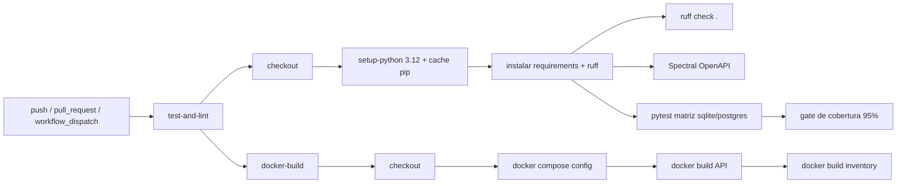

# Aula 22 — Pipeline de CI/CD com GitHub Actions

O SynapseShop passa a validar cada *commit* e *pull request* automaticamente:
lint de Python e do contrato OpenAPI, suíte de testes em SQLite e PostgreSQL e
*build* das imagens Docker. Esta aula cobre apenas **CI**; a publicação em
*registry* e o *deploy* simulado ficam para a Aula 23.

## Objetivo

- Criar `.github/workflows/ci.yml` versionado no repositório.
- Disparar em `push` para `master`/`main`, em `pull_request` para os mesmos
  branches e manualmente via `workflow_dispatch`.
- Correr `pytest` de forma que qualquer teste quebrado falhe o pipeline.
- Correr o linter (`ruff`) e o lint do contrato OpenAPI (Spectral).
- Validar o *build* das imagens Docker sem publicar nada.
- Abstrair segredos: nada sensível no repositório.

## Arquitetura do pipeline



## Gatilhos

| Evento | Configuração |
|---|---|
| `push` | branches `master` e `main` |
| `pull_request` | direcionado a `master`/`main` |
| `workflow_dispatch` | execução manual na aba **Actions** |

O workflow também define `concurrency` para cancelar execuções antigas do mesmo
branch e `permissions: contents: read` (privilégio mínimo).

## Jobs

### `test-and-lint`

Runner `ubuntu-latest`, matriz `engine: [sqlite, postgres]`.

| Passo | Detalhe |
|---|---|
| Checkout | `actions/checkout@v4` |
| Python | `actions/setup-python@v5`, Python 3.12, cache de `pip` |
| Dependências | `pip install -r requirements.txt ruff` |
| Lint Python | `ruff check .` |
| Lint OpenAPI | `npx @stoplight/spectral-cli@6 lint docs/openapi.yaml` (apenas SQLite) |
| Testes | `pytest --cov-fail-under=95` em `api/v1/products` |
| Cobertura | upload de `api/v1/products/.coverage` (apenas SQLite) |

- O serviço `postgres:16-alpine` é efémero e tem *healthcheck*; as credenciais
  são criadas pelo próprio job e não são segredos de produção.
- `DB_ENGINE` seleciona o motor em `products/settings_test.py`.
- `--cov-fail-under` usa `COVERAGE_MIN` (95), abaixo da cobertura atual, para
  absorver variação natural sem bloquear *merges* por um ponto.

### `docker-build`

Runner `ubuntu-latest`, com `needs: test-and-lint` (só corre se os testes
passarem).

| Passo | Comando |
|---|---|
| Validar compose | `docker compose config --quiet` |
| Build da API | `docker build -t synapseshop-api:test .` |
| Build do inventory | `docker build -t synapseshop-inventory:test ./inventory` |

As imagens ficam apenas no runner. Publicação em GHCR/DockerHub é Aula 23.

## Segredos e variáveis

`.env` está no `.gitignore` e não é versionado. Configure em
**Settings → Secrets and variables → Actions**:

| Nome | Obrigatório | Uso |
|---|---|---|
| `SECRET_KEY` | opcional | Chave Django; o workflow usa `ci-insecure-secret-key` quando o segredo não existe |
| `LLM_API_KEY` | não (CI atual) | Testes usam provedor falso; necessária apenas em testes de integração/CD |
| `POSTGRES_*` | não | Credenciais efémeras do serviço PostgreSQL do job |

```bash
# GitHub CLI (opcional)
gh secret set SECRET_KEY
gh secret set LLM_API_KEY
```

`products/settings.py` lê `SECRET_KEY` do ambiente, mantendo a chave de
desenvolvimento como *fallback*. O projeto usa `POSTGRES_USER`,
`POSTGRES_PASSWORD`, `POSTGRES_DB`, `DB_HOST` e `DB_PORT`; não existe `DB_URL`
no código atual.

## Reproduzir localmente

```bash
python tasks.py check   # ruff + Spectral + pytest
python tasks.py build   # docker compose build
```

Validação do YAML sem depender de Python:

```bash
docker run --rm -v "${PWD}:/repo" mikefarah/yq:4 eval /repo/.github/workflows/ci.yml
```

## Validação no GitHub

1. Fazer *push* para `master` (ou abrir um *pull request*).
2. Abrir **Actions → CI** e confirmar os dois jobs verdes.
3. O *badge* no topo do README atualiza automaticamente:

```markdown
[](https://github.com/alanco-oss/synapseshop/actions/workflows/ci.yml)
```

## Troubleshooting

| Sintoma | Causa provável | Ação |
|---|---|---|
| `pytest` falha só em `postgres` | *query* dependente do SQLite ou serviço ainda a arrancar | Ver logs do serviço e `DB_ENGINE`; o *healthcheck* já espera pelo Postgres |
| Falha no *gate* de cobertura | Cobertura abaixo de 95% | Correr `python tasks.py coverage` e cobrir o código novo |
| Spectral falha | Contrato OpenAPI inválido ou `npx` sem rede | Correr `python tasks.py spectral` localmente |
| `docker build` falha | Contexto, `.dockerignore` ou dependência nova | Reproduzir com `docker build -t synapseshop-api:test .` |
| Segredo ausente em PR de fork | GitHub não expõe *secrets* a forks | O *fallback* de `SECRET_KEY` mantém o CI a funcionar |

## Checklist do DoD

- [x] `.github/workflows/ci.yml` versionado.
- [x] *Checkout*, setup do Python, instalação de dependências e linter no CI.
- [x] `pytest` executado e pipeline falha se um teste quebrar.
- [x] *Build* das imagens Docker integrado (`synapseshop-api:test` e inventory).
- [x] Segredos abstraídos e documentados; `SECRET_KEY` lida do ambiente.
- [x] README com explicação do pipeline e *badge* de status.
- [x] Prompts registados em `PROMPTS.md` e `docs/historico/PROMPTS.md`.

## Referências

- [Spec da Aula 22](../../specs/spec_da_aula_22.md)
- [Workflow CI](../../.github/workflows/ci.yml)
- [Comandos de operação](../../tasks.py)
- [Settings de teste](../../api/v1/products/products/settings_test.py)
